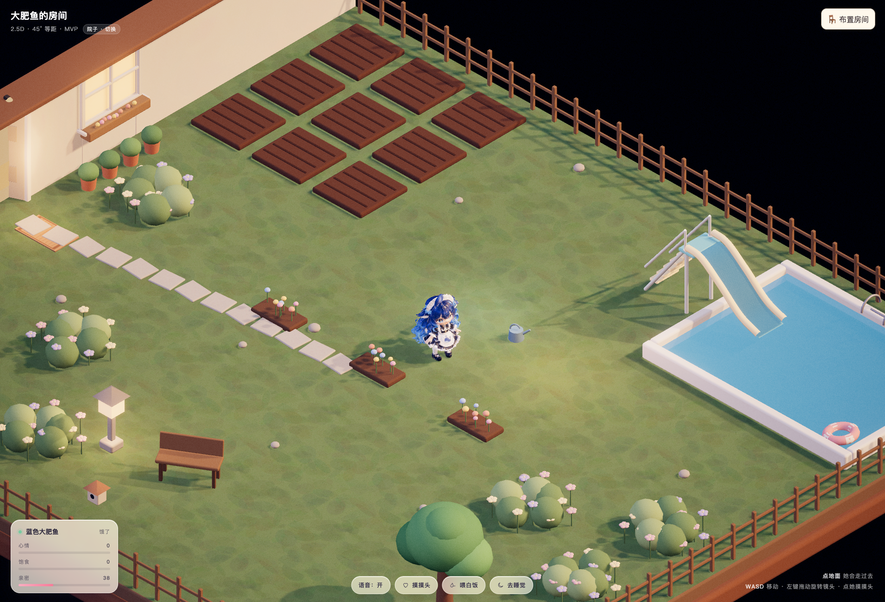

# 大肥鱼的小世界

一个用 Three.js 制作的 2.5D 电子宠物与房间布置原型：给大肥鱼搭个家，陪她活动、吃白饭、游泳，也能调整家具和院子。

**作者 / 抖音：破晓手记**。欢迎搜索「破晓手记」，查看成长与开发记录。

这是一个持续探索的 AI 陪伴小世界，部分动作和交互仍在打磨。世界由规则和程序动画执行，外部智能体通过 MCP 决策，QQ 是聊天入口。

文档：[总览](docs/README.md) · [踩坑日记](docs/PITFALLS.md) · [MCP 对接手册](docs/MCP-QUICKSTART.md) · [Agent / DSH 提示词](docs/MCP-PROMPTS.md)

## 游戏画面




## 快速开始

需要 **Node.js 22.13 或更高版本，推荐 Node.js 24**；数据库使用内置的 `node:sqlite`。

```bash
git clone https://gitee.com/poxiao12138/dafeiyu-room.git
cd dafeiyu-room
npm ci
npm run dev
```

打开 [http://127.0.0.1:5200/](http://127.0.0.1:5200/)。本机打开即可自动进入世界，换浏览器或清除 cookie 后也会自动连接。游戏不再使用主人配对码，MCP 标准 OAuth 授权码与主人确认授权继续保留。

开发命令同时启动前端与存档服务，无需另装数据库。端口固定，占用时先关闭之前启动的服务。

| 运行方式 | 游戏入口 | API 服务 |
| --- | --- | --- |
| `npm run dev` | 5200 | 内部 5201，由前端代理 |
| `npm run build` 后 `npm start` | 5200 | 同一服务提供 |

开发与构建服务不能同时占用 5200。`npm run preview` 仅供前端预览，完整体验使用 `npm start`。

## 角色与资源

克隆后默认使用已适配的鲸鱼娘活泼版，开发与构建一致，资源已包含在项目内。

| 地址参数 | 角色 |
| --- | --- |
| `?character=maid-arms` | 默认活泼版 |
| `?character=maid` | 基础修复版 |
| `?character=paper` | 纸片立绘试验 |
| `?character=whale` | 程序化胖鲸鱼 |

`resources/character/` 保存模型、Blender 源文件、立绘与制作说明；`manifest.json` 记录文件大小和 SHA-256。构建仅打包两个运行模型和一张立绘，其余文件供学习与编辑。

人物适配依赖特定骨骼和动画，替换模型需要同步修改角色代码。模型仍有局部穿插等原型限制，制作说明保留了当时的试验结果。

## 连接智能体（MCP）

进入世界后点击右上角 **「连接智能体」→「复制地址」**，在支持 Streamable HTTP 与 OAuth 的客户端添加连接并确认权限。

默认地址为 `http://127.0.0.1:5200/mcp`；复制内容不含凭证，游戏内可查看和撤销授权。已授权不表示客户端当前在线。

智能体首次调用 `world_enter {}` 即可，省略 `worldId` 会进入当前凭证授权的默认世界，之后使用返回的实际 `worldId`，不要猜世界名。`WORLD_SELECTION_INVALID` 表示世界选择不匹配，可按错误中的 `availableWorldIds` 修正，不需要因此重新授权；凭证过期、撤销或无效才会在连接层返回 401。

世界服务保存状态并执行已接受的动作，后续决策与唤醒由外部宿主负责。QQ 继续作为聊天入口。

部署、权限和 stdio 兼容方式见 [MCP 接入指南](docs/MCP-QUICKSTART.md)，宿主与网络边界见 [兼容说明](docs/MCP-COMPATIBILITY.md)。

可选语音只播放智能体提供的音频，需要单独授权 `audio:play`，并在网页点击「开启声音」。游戏不采集麦克风或合成声音，音频不写入存档。

## 操作与玩法

- WASD 移动；户外拖动空白处水平旋转镜头，室内使用固定等距镜头。
- 户外家具包括秋千、野餐桌、遮阳伞、花箱、花拱门和鸟浴盆；点击秋千可坐下轻摆，目录也向 MCP 开放。
- 点击「布置房间」进入编辑；拖动物件移动，滚轮或 R 旋转，Delete 删除。
- Ctrl/Cmd+Z 撤销，Esc 完成；选中物件可调整高度和缩放。
- 已有卧室、客厅、院子；可通过受控模板创建场景并用双向门槽连接。
- 角色可跨场景移动、坐下、睡觉、吃白饭、游泳和滑梯。
- 九块菜地和保护区域保留，目前尚未实现种植系统。

主人可接管角色；编辑锁、控制租约与版本检查协调多人操作来源。智能体动作需查询终态，才能确认完成。

## 存档与后台活动

初始世界与运行存档分开保存：

- `shared/world/starter-world.json`：随代码发布的卧室、客厅和院子默认布局。
- `data/game.sqlite`：首次启动自动创建的个人存档，保存布局、角色、动作、事件和授权；已被 Git 忽略。

新安装从默认布局创建世界；已有存档继续使用自己的世界，更新代码不会覆盖它。用户或 AI 通过 MCP 的日常改造只写入数据库，不会改写默认配置。

只有准备发布新的默认摆放时，主动运行 `npm run world:publish-default`，检查配置差异后提交代码。该命令只导出当前卧室、客厅和院子的布局，不导出人物状态、授权或操作记录，也不会修改运行存档。新增的其他场景不会自动进入发布默认世界。

备份个人存档前停止服务，再复制整个 `data/`。

服务运行时，关闭网页后已接受的有限动作仍按规则推进。控制租约到期、接管或撤权会取消动作；电脑休眠或服务停止期间不会持续移动，重启从检查点恢复。

这是本地单人世界，默认仅监听 `127.0.0.1`。跨机使用需配置 HTTPS 反向代理和 `WORLD_PUBLIC_URL`，再从实际客户端验证连接。

## 开发与检查

```bash
npm test
npm run self-check
npm run check
```

`check` 运行全部测试、生产构建和公开文件检查；`self-check` 使用临时数据库与真实 SDK 验证授权、创建场景、行动、重启与撤权，不访问已有存档。

公开检查通过清单与摘要验证角色资源，同时拒绝凭证、存档、语音权重、备份和临时文件。修改资源后应核对并更新清单。

## 来源与授权

项目代码及作者有权授权的 `resources/character/` 资源、项目截图随项目采用 [MIT License](LICENSE)，允许使用、修改、分享及商用，须保留版权与许可证声明。

人物资源包含使用付费 Meshy 服务生成的模型，以及破晓手记制作、修复和编辑的源文件；原始版本和腾讯版试验模型一并保留供参考。素材授权以作者实际拥有的权利为范围，第三方组件保留各自许可。

主要依赖 Three.js、Fastify、MCP TypeScript SDK、Zod、Vite、esbuild 与 Playwright；完整版权文本和来源见 [第三方声明](THIRD-PARTY-NOTICES.md)。开发中也参考体验了 [茉莉的小房间 / norsizu](https://github.com/norsizu/moli-room)，其代码与美术许可独立。

欢迎在 Issues 留下问题与建议，或到抖音「破晓手记」评论区交流。
