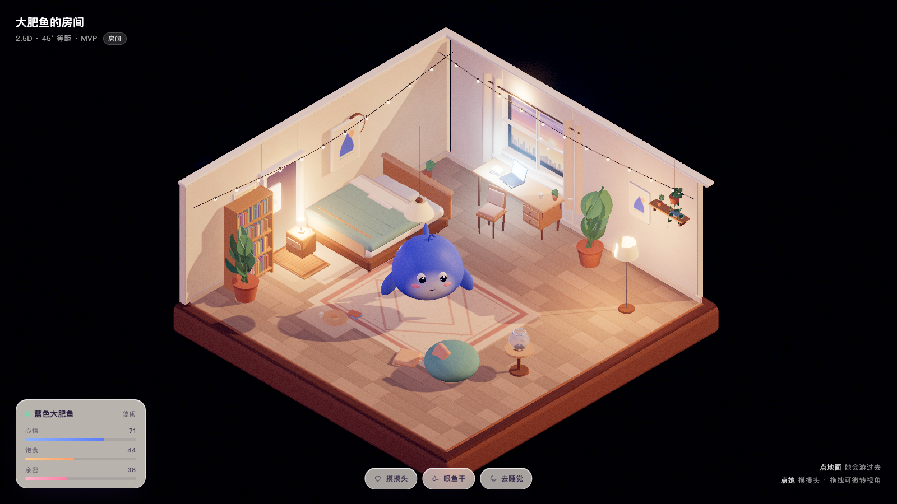
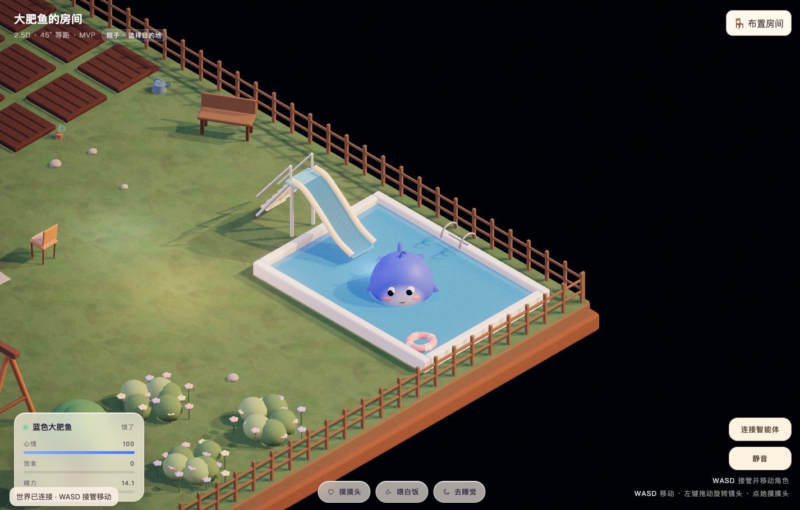

# 大肥鱼的小世界

给大肥鱼搭一个能住、能玩、能慢慢成长的小世界。

**作者 / 开发记录：破晓手记**  
**抖音：破晓手记**（搜索账号名，查看大肥鱼的成长与开发过程）

## 为什么做这个项目

大肥鱼是一个持续迭代中的 AI 陪伴角色。此前的探索围绕聊天、性格、记忆，以及她怎样对世界保持好奇展开；这个项目希望把陪伴从聊天窗口延伸到一个看得见、能互动的小世界。

起点很简单：先给她搭个家。通过自然语言向 DSH 描述需求、反复调整，逐步搭出房间、院子、家具、光影和互动，再从真实试玩中决定下一步。

**当前公开的是独立游戏原型，尚未接入大肥鱼的对话、记忆或自主决策后端。** 现有台词、闲逛和行为来自前端规则，角色语音是演示配音，不能据此认为她已经能自主理解这个世界。

## 游戏画面

以下为开发过程中的实机截图，均只展示胖鲸鱼，不包含私人角色模型。部分界面、道具与布局可能和当前版本不同。

### 房间



### 院子


### 泳池



## 现在可以玩什么

- Three.js 实时渲染的等距场景，包含卧室、客厅和院子。
- 默认主角是由代码生成的圆胖鲸鱼，支持移动、转向、摆尾、眨眼和视线跟随。
- 点击鲸鱼摸头，喂白饭、去睡觉，查看心情、饱食和亲密数值。
- 点击场景热点切换地点，探索院子和泳池。
- 部分互动有角色配音，可通过底部语音开关关闭。

不带私人配置时，开发页面默认使用胖鲸鱼；公开构建也始终使用胖鲸鱼。本地可以通过不提交的配置启用人物版，但人物模型、人物立绘、模型处理工具和相关开发文件不随仓库分发。

## 本地运行

```sh
git clone https://gitee.com/poxiao12138/dafeiyu-room.git
cd dafeiyu-room
npm ci
npm run dev
```

打开终端显示的本地地址。构建与预览：

```sh
npm run build
npm run preview
```

## 日常开发与私人资源

现在使用同一个仓库维护公开版和本地人物版，无需复制两个工程。默认不带本地配置时使用胖鲸鱼。

有私人角色资源的开发者，可在仓库外建立资源目录，包含 `models/`（GLB）及可选的 `characters/`（立绘），再创建不提交的 `character.local.json`：

```json
{
  "defaultCharacter": "maid-arms",
  "assetRoot": "/你的本机私人资源目录"
}
```

### 本地角色选项与资源要求

| `defaultCharacter` | 用途 | 需要自行提供的文件（相对 `assetRoot`） |
| --- | --- | --- |
| `whale` | 程序化胖鲸鱼 | 无 |
| `maid-arms` | 已适配的人物活泼版 | `models/Whale_Maid_Lively.glb` |
| `maid` | 人物基础修复版 | `models/Whale_Maid_Repaired.glb` |
| `paper` | 单张立绘的纸片人试验 | `characters/whale-maid-paper.png`（透明背景） |

这些名称对应现有的专用适配代码，**不是通用模型导入器**。把任意 GLB 改成上述文件名，并不能保证动作正常。人物模型需已正确绑定骨骼和权重，包含 `Idle`、`Walking`、`Running` 动画；本项目适配文件的站立高度约为 1 米，脚底在模型原点。手部、头发、尾巴等附加效果还依赖特定骨骼名称，换模型时需要修改 `src/characters/whaleMaid.js` 的匹配与控制逻辑。

已有适配使用 `Head`、`UpperArm.L/R`、`Forearm.L/R`、`Hand.L/R` 和 `Tail` 等骨骼；长发使用 `HairLeftRoot/Tip`、`HairRightRoot/Tip`、`HairBackRoot/Tip`。没有这些骨骼时，对应附加效果不会自动出现。模型本身不在仓库中，需使用自己有权使用的资源。

保存或修改 `character.local.json` 后重启开发服务。启用本地资源时，也可用 `?character=whale` 或 `?character=maid-arms` 临时切换；没有私人配置时，即使网址带有人物参数也会回退到鲸鱼版。

`npm run dev` 仅在本地开发时读取配置和提供私人资源。`npm run build` 始终生成默认胖鲸鱼的公开版本，不读取或复制私人模型。其他人克隆仓库后不需要人物资源也能运行。

发布前执行：

```sh
npm run build
npm run check:public
git status
```

确认文件清单后正常提交和推送。`.gitignore`、生产构建隔离以及公开检查共同避免上传私人资源；不要强制添加忽略的文件。

## 接下来想做什么

这些是探索方向，**尚未完成，也不是已上线功能**：

1. **接上真正的大肥鱼**：让互动进入记忆，让角色结合性格和当前状态回应；把“说了什么”与“做了什么”连接起来。
2. **自己的生活节奏**：逐步加入作息、天气、兴趣和连续行为，让她能自己找事做。
3. **更多生活玩法**：尝试种地、打工、盖房子、上学等活动，让这些活动与角色成长关联。
4. **朋友与社交**：让不同角色进入同一个世界，有自己的活动和相互影响。
5. **先把基础体验做好**：持续改善移动、避障、互动反馈、存档和移动端体验。

欢迎在仓库的「Issues（问题与建议）」中留言，也可以到抖音「破晓手记」评论区，说说你想让大肥鱼在这里做什么。项目会根据实际体验逐步迭代。

## 第三方来源与致谢

本项目不是从零实现渲染引擎。使用的主要开源组件如下：

| 项目 / 作者 | 用途 | 许可证 |
| --- | --- | --- |
| [Three.js / three.js authors](https://github.com/mrdoob/three.js) | 三维渲染、几何、材质，以及相机控制相关数学能力；所用后处理和几何 addons 也来自 Three.js | MIT |
| [Vite / Vite contributors](https://github.com/vitejs/vite) | 开发服务器和构建 | MIT |
| [esbuild / Evan Wallace and contributors](https://github.com/evanw/esbuild) | 开发构建工具依赖 | MIT |
| [Playwright / Microsoft and contributors](https://github.com/microsoft/playwright) | 开发阶段测试依赖 | Apache-2.0 |

开发时也体验和调研过 [茉莉的小房间 / norsizu](https://github.com/norsizu/moli-room)，用于思考小房间陪伴、自主活动等方向。本公开仓库不附带该项目文件；其代码与美术的许可独立于本仓库，不因这里的致谢而改变。

房间、家具、胖鲸鱼和程序化贴图的实现位于 `src/`；内置配音来自本项目开发视频中的角色演示音频。公开版不附带视频配乐或私人人物模型。

详细组件版本、Three.js 版权文本及素材范围见 [THIRD-PARTY-NOTICES.md](THIRD-PARTY-NOTICES.md)。如发现遗漏的来源，请通过 Issues 提供具体文件和出处，以便核对补充。

## 授权说明

本项目自身的游戏源码采用 [MIT License](LICENSE)，允许使用、修改、分享及商用，须保留版权声明和许可证文本。第三方组件遵循各自许可证。

**MIT 授权范围仅为项目自身的游戏源码，不是对所有仓库文件的一揽子授权。**

| 内容 | 授权范围 |
| --- | --- |
| 本项目游戏源码 | MIT，允许修改、分发和商用，须保留版权与许可证声明 |
| 第三方依赖 | 各自原许可证，详见第三方声明 |
| 内置配音 `public/voices/dafeiyu/` | 不纳入源码 MIT 授权；未在此授予商用、独立再利用或再分发许可，相关用途需另获授权 |
| README 截图 `docs/screenshots/` | 用于本仓库项目展示；不随源码 MIT 授权自动获得独立再利用许可 |
| 私人人物模型和立绘 | 未分发，不在本仓库授权范围内 |

**商业发布时，不应直接把本仓库附带的配音一起打包。** 请先取得音频所需授权，或将其替换成自行制作、具有相应用途授权的音频，并同步更新 `src/ui/voice-clips.json` 的路径、台词和时长。游戏里的“语音关闭”按钮只停止播放，并不会从构建产物中移除音频文件。

这一素材范围限制不改变游戏源码的 MIT 商用许可。
