# 大肥鱼的小世界

一个用 Three.js 制作的 2.5D 陪伴与探索游戏。和大肥鱼一起布置家、养宠物、练魔法，或带上伙伴去森林对战、逛潮汐海岛、骑扫把飞过花海。

**作者 / 抖音：破晓手记**

[快速启动](#快速启动) · [联机与社区](#联机与社区) · [玩法与场景](#玩法与场景) · [操作按键](#操作按键) · [MCP 智能体](#mcp-智能体) · [开发与文档](#开发与文档) · [项目来源与许可](#项目来源与许可)

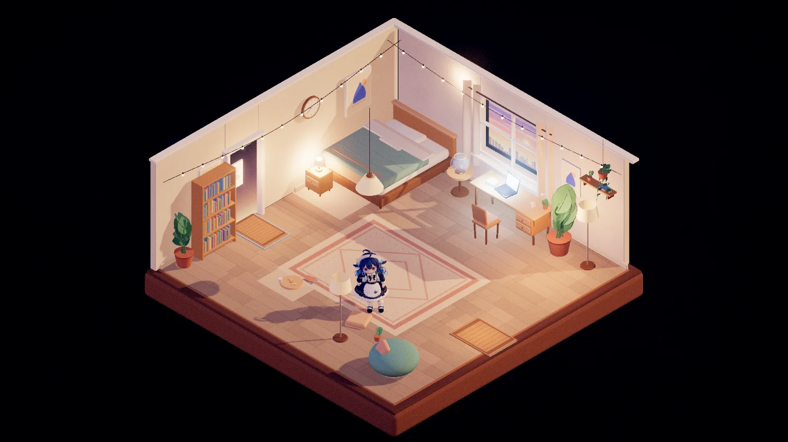

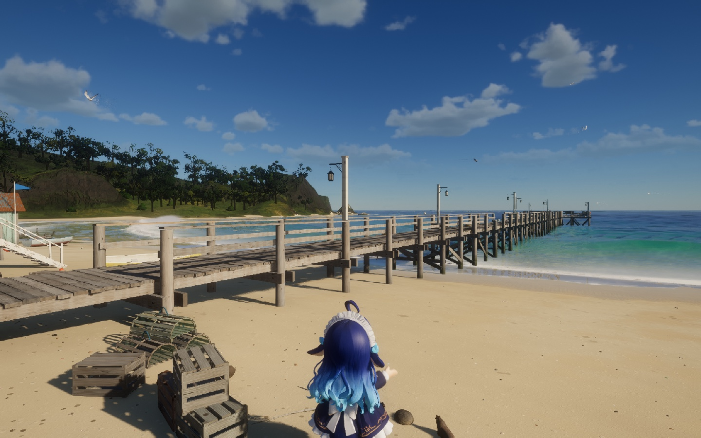

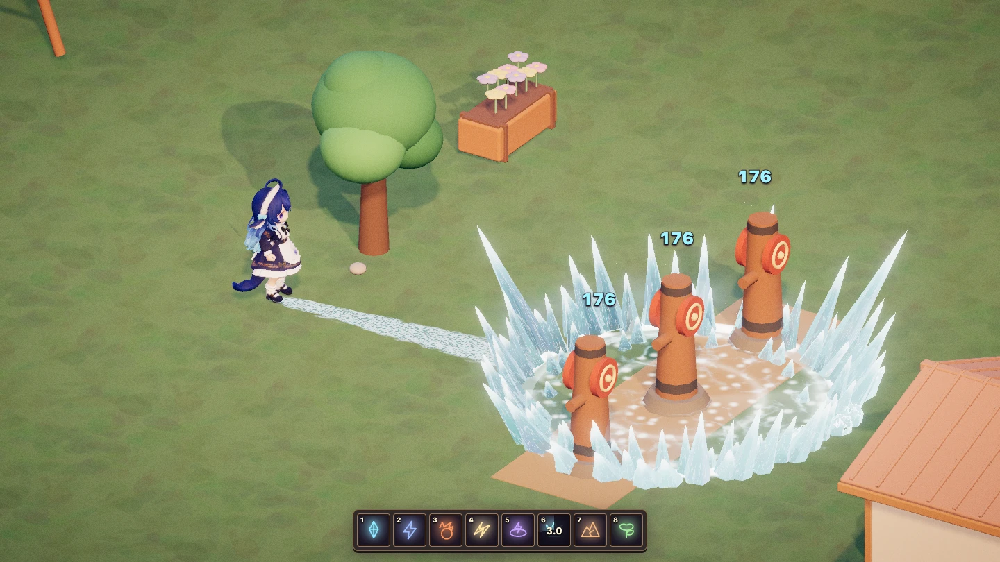

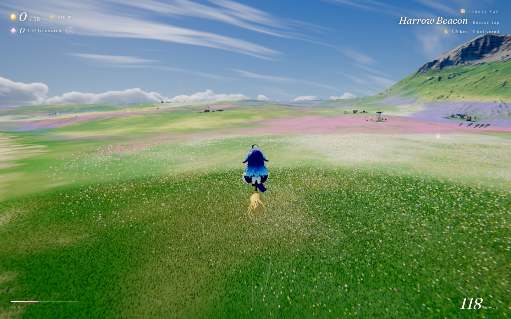

## 快速启动

需要 Node.js 22.13 或更新版本，推荐 Node.js 24。

### 浏览器版

```bash
git clone https://gitee.com/poxiao12138/dafeiyu-room.git
cd dafeiyu-room
npm ci
npm run dev
```

`npm run dev` 会启动网页和本地游戏服务。用浏览器打开 [http://127.0.0.1:5200/](http://127.0.0.1:5200/)。第一次启动会自动创建存档。

本地运行默认是单机模式，不登录也能直接游玩。需要联机时，可以打开游戏内的账号面板，使用方式和测试说明见[联机与社区](#联机与社区)。

### Electron 桌面版

桌面壳源码随仓库提供。执行过 `npm ci` 后，从项目根目录开两个终端：

```bash
# 终端 1，启动本地游戏服务
npm run dev

# 终端 2，打开 Electron 窗口
npm run desktop:dev
```

游戏服务已经在运行时，直接执行 `npm run desktop:dev` 即可。打包和存档位置见[桌面版说明](docs/DESKTOP.md)。

## 联机与社区

联机服务由 **昊天兽王** 提供。服务器目前仍在测试中，功能和稳定性还有需要完善的地方，感谢大家愿意帮忙体验。如果遇到登录失败、角色模型加载较慢、位置不同步或其他问题，欢迎到 [Issues](https://gitee.com/poxiao12138/dafeiyu-room/issues) 提交反馈。如果方便，请附上客户端版本、设备与系统、复现步骤和截图，便于排查。

### 在线版

可以直接打开[大肥鱼在线版](https://dsh.xn--n6qv0quslfsn.top/game/)。在线版使用上面的社区服务器，未登录时会先进入登录或注册页面；登录后进入网页游戏。在线版部署在 `/game/` 路径，游戏通过同源 `/community-api` 访问联机接口。

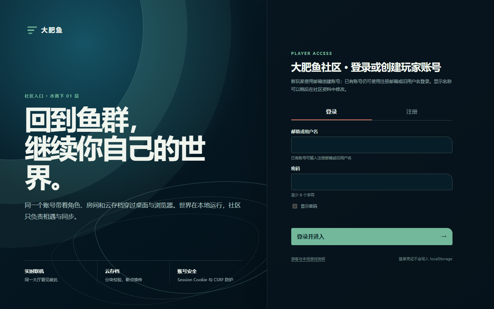

### 开始联机

打开游戏内的账号面板，使用邮箱注册，分别同意用户协议和隐私政策，并点击验证邮件中的链接完成注册。登录后仍使用本地世界，联机默认开启，也可以在账号面板中关闭。关闭联机后会停止位置共享和附近聊天，好友聊天和个人布局的云同步仍可使用。

公共大厅、街角与海岸是公开区域；卧室、客厅和院子属于私宅，默认不向其他玩家广播位置，访客需要房主的有效邀请才能加入。

### 已实现（测试中）

- **账号与联机开关**：邮箱验证注册、登录与退出，以及独立的联机状态切换。
- **公共区域联机**：显示同区域的在线玩家，同步角色位置、朝向与基础动作，支持附近聊天。
- **好友与私聊**：查找玩家、发送和处理好友申请、管理好友，以及好友私聊和历史消息。
- **同账号位置同步**：网页端与本地运行的游戏之间同步角色位置和所在场景，重新进入时恢复位置。
- **私宅邀请访问**：房主邀请其他玩家进入私宅，当前访客只读，暂不支持共同布置或建造。
- **个人布局云同步**：个人场景与家具布局的云端保存、恢复和跨设备同步。

这些功能已接入当前测试版本，仍需要更多真实设备与网络环境的验证。云同步目前以个人场景和家具布局为主，尚未覆盖宠物、背包、战斗等全部游戏状态。

### 后续计划

- 继续优化首次角色模型加载和多人场景性能，改善弱网、断线重连和同步体验。
- 完善私宅访问与多人互动，探索共同布置和建造。
- 逐步评估宠物、背包等更多游戏数据的跨设备同步。
- 根据多设备、多账号测试的反馈持续修复问题。

以上是后续完善方向，具体安排会根据测试反馈调整，目前还没有确定的上线时间。

## 玩法与场景

### 家园与街区

- **一起生活**。点击大肥鱼摸头，用右上角的「喂饭」挑食物，点击床让她睡觉。她掉进泳池会变成胖鲸鱼，上岸恢复人形。
- **布置自己的家**。打开「布置房间」，从家具目录挑选物件，拖动、旋转，摆好后保存。
- **去院子练招**。可以出拳、踢腿、翻滚、二段跳，也可以用八种魔法攻击训练木桩，看受击反馈和伤害数字。
- **逛街角便利店**。从传送菜单前往街区，看看停车场、街边小屋和沿街摆设。

### 宠物、背包与堆肥

1. 打开院子大树下的宝箱，孵化白泽和缸盆小鱼。右上角的「宠物」栏可以查看饱食度、羁绊、属性和技能，指定跟随、家园待命和出战的宠物。跟随和出战各可指定一只。
2. 点击宠物的头可以抚摸它。在宠物栏的「食物」页把食物放到地上，宠物会自己走过去吃。留在院子的宠物会散步和做待机动作。
3. 点击地上的便便可以捡进「背包」。拖动可以调整格子，也可以把便便拖回院子。农田边的堆肥箱能把便便变成肥料，放入后约两分钟就能收取。宠物栏可单独设置排便频率，慢档 8 小时、中档 2 小时、快档 10 分钟，默认中档。

已有存档的旧背包会合并进世界存档。地面空间不足时，先拾取地上的物品腾出空位，游戏会自动重试。

### 森林与回合制对战

从左侧传送菜单选择「森林 → 入口」或「森林 → 湖泊」。新旧存档首次传送都会按需创建森林，已有森林会直接复用。回家时，在同一个菜单选「院子」或「卧室」。

设为跟随的宠物会跟着大肥鱼沿林间小路和石阶上山。山顶湖可以游泳，按 C 潜水，再按 C 或空格浮出水面。沿湖边继续走，可以到后山的开阔平台。

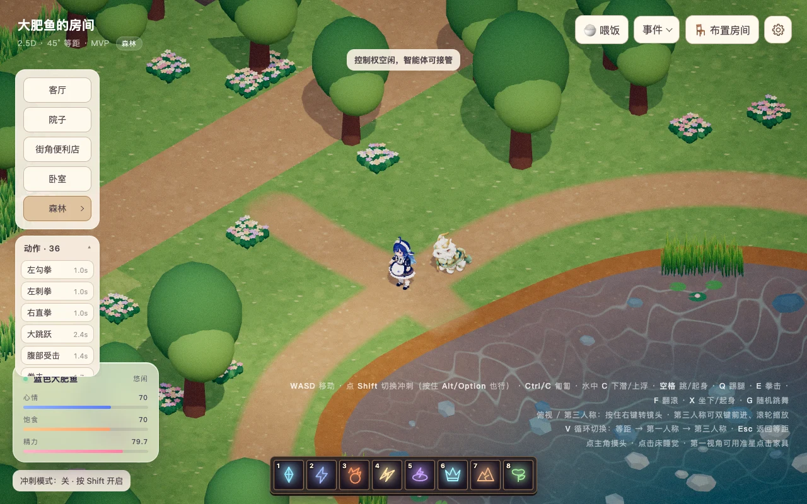

从森林入口沿路往里走，踏进路边的大片高草，在草里多走几步就有机会遇到野生白泽。遇敌后会切入独立的对战画面，大肥鱼站后排，已设为出战的宠物站前排，对面可能同时出现多只野生白泽。

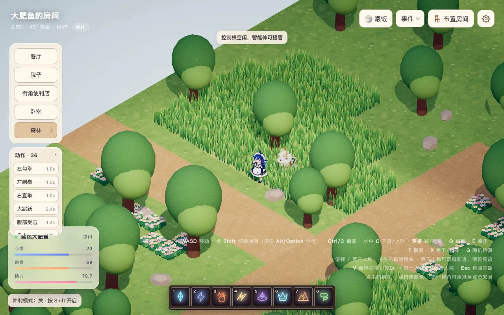

1. 双方就位后开始读秒，每回合有 **30 秒**。点击敌人的模型或名牌，打开大肥鱼的技能菜单。
2. 鼠标移到技能上，敌人脚下会亮起对应的单体、T 字范围或全体目标。选好大肥鱼的技能后，再给出战宠物选招，并点击敌人确认目标。
3. 指令选齐或倒计时结束后结算回合。超时还没收到指令的单位本回合待命。击败敌方后会自动回到森林，也可以选择逃跑。

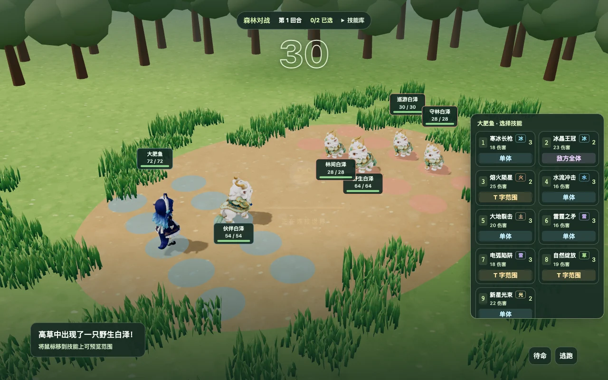

### 潮汐海岛与飞行王国

从左侧场景选择器进入，按 Esc 或点击「返回小世界」退出。

- **潮汐海岛**。沿沙滩走到木码头，按 V 切换第一、第三人称。海岛需要 WebGPU。
- **飞行王国**。点击「起飞」，骑扫把飞过花海和城镇。用 WASD 操控，按 Shift 乘风加速，按 C 切换镜头。

<details>
<summary>更多家园截图</summary>


| 客厅 | 院子 |
| --- | --- |
| 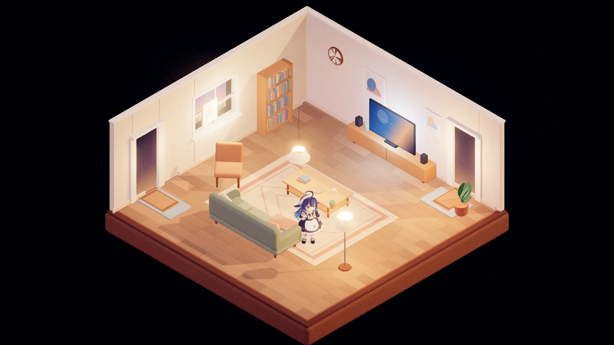 | 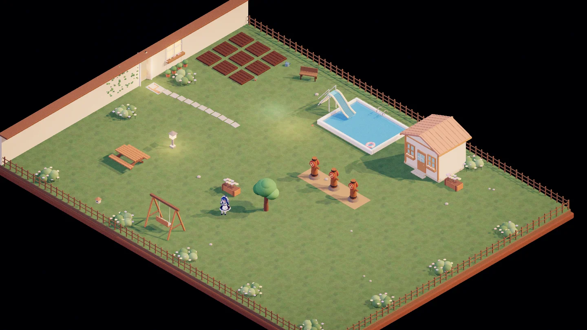 |
| **泳池变身** | **家具编辑** |
| 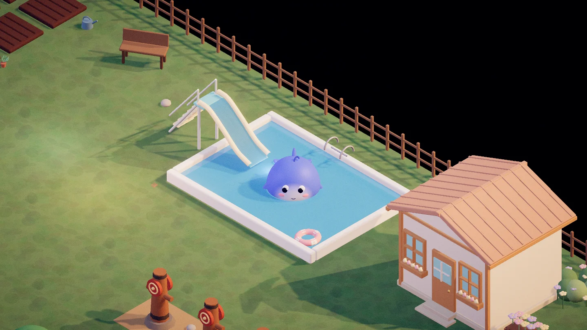 | 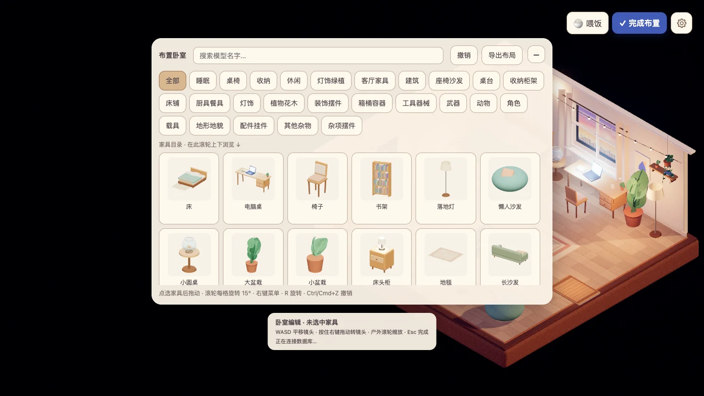 |

</details>

## 操作按键

以下按键用于大肥鱼主场景。海岛和飞行王国的操作见各自的场景提示。

| 按键 | 操作 |
| --- | --- |
| WASD / Shift | 移动 / 切换冲刺 |
| V / Esc | 切换等距、第一人称、第三人称视角 / 返回等距 |
| 按住鼠标右键 | 在等距和第三人称视角旋转镜头 |
| 空格 / C | 跳跃，空中再按可二段跳 / 匍匐、冲刺中滑铲、水中潜水 |
| Q / E / F | 踢腿 / 拳击 / 翻滚 |
| X / G | 坐下 / 随机跳舞 |
| 1–8 | 探索时选中魔法，瞄准后左键施放 |

## MCP 智能体

授权后的智能体可以探索场景、与家具互动、布置房间，也能照看宠物和打理院子。你可以让它攻击指定木桩，游戏负责跑位、瞄准和施法。按 WASD 可随时接管角色。

[查看 MCP 接入手册](docs/MCP-QUICKSTART.md)

## 开发与文档

### 公开资源与本机素材

公开版自带大肥鱼、白泽和缸盆小鱼的模型与动画、四个初始场景、按需创建的森林、游戏内置配音、音效和背景音乐，以及 146 个 Polyfork 精选模型与缩略图。全量模型库和个人存档保存在本机。想扩展小镇或海滩，可以在游戏里导入自有素材包。

[本地素材导入](docs/LOCAL-ASSETS.md) · [存档与默认世界](docs/WORLD-SAVES.md) · [提交与发布检查](docs/RELEASING.md)

### 社区连接配置

游戏端统一请求同源路径 `/community-api`。开发时由 Vite 代理到社区服务，默认地址为 `https://dsh.xn--n6qv0quslfsn.top`；打包桌面客户端由内嵌的本地游戏服务代理到同一地址。可通过 `VITE_COMMUNITY_API_PROXY_TARGET` 指定其他测试目标，或在页面 URL 中使用 `?community_api=` 临时覆盖。

```powershell
# 临时连接其他本地社区服务
$env:VITE_COMMUNITY_API_PROXY_TARGET='http://127.0.0.1:4311'
npm run dev
```

独立的云端社区服务为闭源服务，本次提交只包含游戏端、在线版构建配置和公开资源；服务器业务代码与部署文件不在提交范围内。

游戏仓库内仍包含本地运行所需的公开接口：账号位置同步、个人布局导入导出、结构化布局同步、世界包导入导出、公共大厅初始化，以及把 `/community-api` 转发到云端社区服务的同源代理。它们只负责本地游戏运行和协议衔接，不包含云端社区服务的业务实现。

### 构建与开发

- `npm run build` 后执行 `npm start`，可以运行生产构建。
- `npm run check` 运行测试、构建和公开资源检查。
- [Three.js 开发 Skills](docs/THREEJS-SKILLS.md)列出游戏开发用的 9 个 skill 和安装方法。
- [文档目录](docs/README.md)收录开发、验收和兼容说明。

## 项目来源与许可

- **潮汐海岛**改编自 Dan Greenheck 的 Tidewater，原项目代码采用 MIT 许可。 [原项目](https://github.com/dgreenheck/tidewater) · [素材署名与许可](docs/TIDEWATER.md)
- **飞行王国**改编自 Jacob Miller（jjcm）的 Petalwake，原项目代码采用 MIT 许可。生成素材的来源和适用条款见场景许可说明。 [原项目](https://github.com/jjcm/petalwake) · [素材署名与许可](docs/PETALWAKE.md)

项目代码和作者有权授权的资源采用 [MIT License](LICENSE)。Polyfork 精选模型按 CC BY 4.0 分发，逐项署名见 [Polyfork 署名](resources/polyfork/CREDITS.md)。其他素材和依赖的来源见 [第三方声明](THIRD-PARTY-NOTICES.md)。

## 在线版使用的模型资源

检查当前联机和在线版代码后，除了大肥鱼本体，还会用到以下模型资源：

- **`Dafeiyu-web-v1.glb` / `Dafeiyu-web-v1.glb.gz`**：本次新增的网页优化版大肥鱼模型。在线版和本地版默认优先使用它；`.gz` 文件用于在线部署时的压缩传输。
- **`baize.glb`**：伙伴白泽、野生白泽和白泽对战使用的模型。
- **`fish-bowl.glb` / `fish-bowl-anims.glb`**：缸盆小鱼的模型和独立动画资源。
- **`Dafeiyu.glb`**：原有大肥鱼模型，继续随包保留用于兼容；当前默认角色加载会切换到网页优化版。
- **`resources/polyfork/glb/`**：场景布置和本地素材目录使用的 Polyfork 模型，在线版构建会一并提供并按需加载。

这些模型都属于游戏端资源，云端社区服务只提供账号、联机和同步接口。模型来源与授权说明见[第三方声明](THIRD-PARTY-NOTICES.md)、[潮汐海岛许可](docs/TIDEWATER.md)和[飞行王国许可](docs/PETALWAKE.md)。
