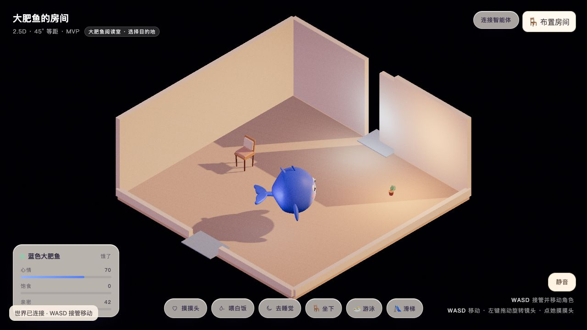
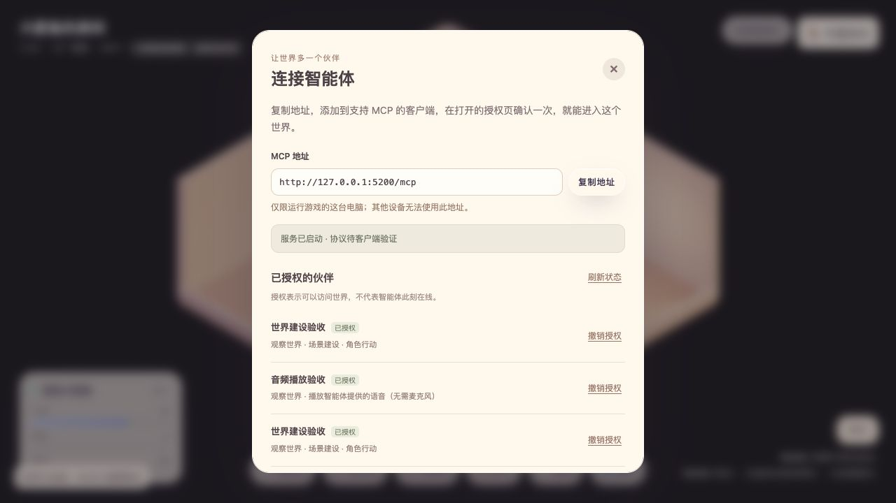

# 大肥鱼的小世界

一个用 Three.js 制作的 2.5D 电子宠物与房间布置原型：给大肥鱼搭个家，陪她活动、吃白饭、游泳，也能自己调整家具和院子。

**作者 / 抖音：破晓手记**。欢迎搜索「破晓手记」，查看大肥鱼的成长和开发记录。

> 公开版默认使用程序化胖鲸鱼，不包含私人人物模型。世界由规则与程序动画执行；外部智能体通过 MCP 决策，QQ 是唯一聊天入口。

## 项目背景

大肥鱼是一个持续探索中的 AI 陪伴角色。这个项目希望把陪伴从聊天窗口延伸到一个可见、可互动的小世界：先有一个能生活的家，再根据实际体验逐步增加活动和成长。

开发通过自然语言描述需求与反复试玩推进。本项目是可运行的探索原型，部分动作和交互仍在打磨，不代表完整商业游戏。

## 连接智能体（MCP）

启动后先使用终端的一次性主人配对码进入世界，再点击右上角 **「连接智能体」→「复制地址」**，在支持 Streamable HTTP 与 OAuth 的客户端添加连接并确认权限。默认地址 `http://127.0.0.1:5200/mcp`，复制内容不含凭证；游戏内可查看和撤销授权。聊天沿用 QQ 作为唯一入口，游戏不提供额外聊天界面。部署地址、权限与 stdio 兼容方式见 [MCP 接入指南](docs/MCP-QUICKSTART.md)。

世界服务保存状态并执行已接受的动作；自主决策由外部智能体提供。已授权不表示客户端当前在线。

## 游戏画面

以下两张为公开胖鲸鱼版的 MCP 实机验收画面：通过接口创建并连接阅读室，角色沿通道走入；连接面板提供地址复制和授权管理。





下面的卧室、庭院和编辑截图由项目作者提供并同意公开展示，使用本地人物版。**公开代码默认使用胖鲸鱼，人物模型和立绘文件不随仓库提供，也不因截图展示而获得使用授权。**

### 卧室与电脑互动


### 庭院、九宫格农田与泳池滑梯


### 家具编辑模式


## 快速开始

需要 **Node.js 22.13 或更高版本，推荐 Node.js 24**，数据库使用 Node.js 内置的 `node:sqlite`。

```bash
git clone https://gitee.com/poxiao12138/dafeiyu-room.git
cd dafeiyu-room
npm ci
npm run dev
```

打开 **[http://127.0.0.1:5200/](http://127.0.0.1:5200/)**。

`npm run dev` 同时启动游戏前端和存档后端。无需另外安装数据库软件，也不需要私人模型。

| 运行方式 | 游戏入口 | API 服务 |
| --- | --- | --- |
| 开发：`npm run dev` | 5200 | 内部 5201，前端代理 `/api`、`/mcp`、`/oauth`、`/.well-known` |
| 构建运行：`npm run build` 后 `npm start` | 5200 | 同一服务提供 `/api` |

端口固定，不会自动跳到其他端口；占用时先关闭之前启动的本项目服务或占用程序，再重试。开发服务和构建服务都使用 5200，二者不能同时启动。

如需分别运行，使用 `npm run dev:frontend` 和 `npm run dev:server`。`npm run preview` 仅预览构建后的前端，数据库功能需另开 `npm run dev:server`；完整体验优先使用 `npm start`。

## 当前功能与规则

- 已有卧室、客厅、院子，也可从受控室内/户外模板创建新场景；以双向门槽连接现有院子。未接通的场景保持草稿。
- 家具支持地面摆放、旋转、缩放，以及受支持的桌面物件；目录、区域与布局建议帮助规整建设。预览不改世界，提交有版本检查、冲突提示和撤销依赖保护。
- 角色可按导航跨场景移动、坐下、睡觉、吃白饭、游泳和滑梯。动作返回 `actionId`，查询终态才能确认完成；位置和需求以服务端为准。
- 室内固定 45° 水平朝向和等距俯角；户外仅水平旋转。镜头高度和俯角固定，MCP 不能修改。WASD 控制移动，室外拖动空白处转动镜头。
- 主人可布置当前场景，查看场景列表、活动记录、连接状态并接管角色；编辑锁、控制租约和版本检查防止同时覆盖。
- 九块菜地与保护区域保留，建设不能移动或侵占；目前没有种植系统。街道、故事和 NPC 留待后续。
- QQ 是唯一聊天入口。可选音频播放见下文；不提供手机消息、麦克风、识别、合成或本地语音模型。

点击「布置房间」编辑；拖动物件移动、滚轮或 R 旋转，Delete 删除，Ctrl/Cmd+Z 撤销，Esc 完成。选中物件后可调整高度与缩放；桌面物件须通过支撑关系校验。新场景使用同一目录、导航、编辑和相机规则。

## 存档与后台活动

技术栈为 Three.js、Vite、Node.js、Fastify、SQLite；首次启动自动建立 `data/game.sqlite`。主人配对、授权、世界布局、角色、动作、事件和消费游标保存在数据库中。首次迁移保留原布局；迁移后旧布局写接口返回待合并草稿，不能覆盖世界。浏览器本地布局仅作恢复草稿与备份。

世界服务持续运行时，关闭网页或 MCP 连接后，已接受的有限动作仍按规则推进。游戏不会自行生成下一条智能体指令；后续决策与唤醒由外部宿主负责。60 秒控制租约到期、接管或撤权会取消动作。电脑休眠、关机或服务停止时不声称角色仍在走动；重启从检查点恢复，长间隔只补算需求，移动按后续实际 tick 推进。

重新连接先调用 `world_enter`，读取位置、未完成动作、未读计数与 `lastConfirmedCursor`。读取 `world_get_events` 后显式 `world_ack_events`；读取不等于消费。历史已清理时先处理返回的 `recoverySnapshot`，再用 `recoveryToken` 确认 `recoveryCursor`，避免静默跳过缺口。

这是本地单人世界；OAuth 授权隔离智能体权限和事件消费，并非多用户云游戏。默认仅监听 `127.0.0.1`。跨机需要运营者配置 HTTPS 反向代理和 `WORLD_PUBLIC_URL`，详见 [接入指南](docs/MCP-QUICKSTART.md)；本机测试不证明外网可达。备份前停止服务，再复制整个 `data/` 目录。

## 验证命令

```bash
npm test
npm run self-check
npm run build
npm run check:public
# 或一次运行测试、构建、公开检查
npm run check
```

`npm test` 运行全部测试；`self-check` 用临时数据库与临时 loopback 端口，经真实 SDK OAuth/HTTP 创建、连接、布置两个场景，往返、坐下、断开后完成吃饭，再重启校验游标和撤权。时钟受控但调用真实运行器，不伪造动作结果，也不访问现有存档。浏览器听音、具体宿主与跨设备联通需要分别验收，见 [兼容边界](docs/MCP-COMPATIBILITY.md)。

## 日常开发与私人资源

现在使用同一个仓库维护公开版和本地人物版，无需复制两个工程。默认不带本地配置时使用胖鲸鱼。

有私人角色资源的开发者，可在仓库外建立资源目录，包含 `models/`（GLB）及可选的 `characters/`（立绘），再创建不提交的 `character.local.json`：

```json
{
  "defaultCharacter": "maid-arms",
  "assetRoot": "/你的本机私人资源目录"
}
```

### 本地角色选项与资源要求

| `defaultCharacter` | 用途 | 需要自行提供的文件（相对 `assetRoot`） |
| --- | --- | --- |
| `whale` | 程序化胖鲸鱼 | 无 |
| `maid-arms` | 已适配的人物活泼版 | `models/Whale_Maid_Lively.glb` |
| `maid` | 人物基础修复版 | `models/Whale_Maid_Repaired.glb` |
| `paper` | 单张立绘的纸片人试验 | `characters/whale-maid-paper.png`（透明背景） |

这些名称对应现有的专用适配代码，**不是通用模型导入器**。把任意 GLB 改成上述文件名，并不能保证动作正常。人物模型需已正确绑定骨骼和权重，包含 `Idle`、`Walking`、`Running` 动画；本项目适配文件的站立高度约为 1 米，脚底在模型原点。手部、头发、尾巴等附加效果还依赖特定骨骼名称，换模型时需要修改 `src/characters/whaleMaid.js` 的匹配与控制逻辑。

已有适配使用 `Head`、`UpperArm.L/R`、`Forearm.L/R`、`Hand.L/R` 和 `Tail` 等骨骼；长发使用 `HairLeftRoot/Tip`、`HairRightRoot/Tip`、`HairBackRoot/Tip`。没有这些骨骼时，对应附加效果不会自动出现。模型本身不在仓库中，需使用自己有权使用的资源。

保存或修改 `character.local.json` 后重启开发服务。启用本地资源时，也可用 `?character=whale` 或 `?character=maid-arms` 临时切换；没有私人配置时，即使网址带有人物参数也会回退到鲸鱼版。

`npm run dev` 仅在本地开发时读取配置和提供私人资源。`npm run build` 始终生成默认胖鲸鱼的公开版本，不读取或复制私人模型。其他人克隆仓库后不需要人物资源也能运行。

发布前执行：

```sh
npm run build
npm run check:public
git status
```

确认文件清单后正常提交和推送。`.gitignore`、生产构建隔离以及公开检查共同避免上传私人资源；不要强制添加忽略的文件。

## 后续方向

以下为计划与探索方向，尚未全部实现：

1. 扩充模板和受控家具，改善新场景构图。
2. 改善角色坐姿、攀梯、滑行、避障及触摸操作体验。
3. 把农田从摆件发展为可种植、可收获的生活玩法。
4. 通过外部智能体的性格和记忆让 QQ 对话与世界状态关联。
5. 在基础体验稳定后，再考虑账号、多人或跨设备存档。

欢迎在仓库「Issues（问题与建议）」留言，或到抖音「破晓手记」评论区交流想法。

## 第三方来源与致谢

本项目不是从零实现渲染引擎。使用的主要开源组件如下：

| 项目 / 作者 | 用途 | 许可证 |
| --- | --- | --- |
| [Three.js / three.js authors](https://github.com/mrdoob/three.js) | 三维渲染、几何、材质，以及相机控制相关数学能力；所用后处理和几何 addons 也来自 Three.js | MIT |
| [Fastify / Fastify team](https://github.com/fastify/fastify) | 本地布局存档 API | MIT |
| [@fastify/static / Fastify team](https://github.com/fastify/fastify-static) | 构建产物的静态文件服务 | MIT |
| [MCP TypeScript SDK](https://github.com/modelcontextprotocol/typescript-sdk) | MCP 与 OAuth 协议 | MIT |
| [Zod](https://github.com/colinhacks/zod) | 工具输入校验 | MIT |
| [Vite / Vite contributors](https://github.com/vitejs/vite) | 开发服务器和构建 | MIT |
| [esbuild / Evan Wallace and contributors](https://github.com/evanw/esbuild) | 开发构建工具依赖 | MIT |
| [Playwright / Microsoft and contributors](https://github.com/microsoft/playwright) | 开发阶段测试依赖 | Apache-2.0 |

开发时也体验和调研过 [茉莉的小房间 / norsizu](https://github.com/norsizu/moli-room)，用于思考小房间陪伴、自主活动等方向。本公开仓库不附带该项目文件；其代码与美术的许可独立于本仓库，不因这里的致谢而改变。

房间、家具、胖鲸鱼和程序化贴图的实现位于 `src/`。公开版不附带视频配乐或私人人物模型。

详细组件版本、Three.js 版权文本及素材范围见 [THIRD-PARTY-NOTICES.md](THIRD-PARTY-NOTICES.md)。如发现遗漏的来源，请通过 Issues 提供具体文件和出处，以便核对补充。

## 授权说明

本项目自身的游戏源码采用 [MIT License](LICENSE)，允许使用、修改、分享及商用，须保留版权声明和许可证文本。第三方组件遵循各自许可证。

**MIT 授权范围仅为项目自身的游戏源码，不是对所有仓库文件的一揽子授权。**

| 内容 | 授权范围 |
| --- | --- |
| 本项目游戏源码 | MIT，允许修改、分发和商用，须保留版权与许可证声明 |
| 第三方依赖 | 各自原许可证，详见第三方声明 |
| README 截图 `docs/screenshots/` | 用于本仓库项目展示；不随源码 MIT 授权自动获得独立再利用许可 |
| 私人人物模型和立绘 | 未分发，不在本仓库授权范围内 |


这一素材范围限制不改变游戏源码的 MIT 商用许可。

### 智能体语音播放

游戏只播放智能体已经生成的声音，不进行语音合成，也不采集麦克风。QQ 仍是聊天入口。需要单独申请可选 OAuth 权限 `audio:play`（连同 `world:read`），主人在授权页确认“播放智能体提供的语音”，进入游戏后点“开启声音”。默认授权不含此权限。

智能体调用 `audio_play({requestId,audioBase64,mimeType})`，支持 `audio/mpeg`、`audio/wav`、`audio/ogg`，原始文件最多 4 MiB、时长最多 60 秒。只接收音频内容，不接收 URL 或本地路径。返回 `playbackId` 后使用 `audio_get_status({playbackId})` 查询，或 `audio_stop({requestId,playbackId})` 取消。工具返回的 `delivery: delivered_not_heard` 只表示播放回执，无法证明主人听见；`started` 来自 HTMLAudio 的真实播放事件，`finished` 来自结束事件。浏览器阻止播放会返回 `blocked`；没有播放网页时为 `client_offline`。

网页以单一播放主页面顺序播放；其他窗口不会重复播放。点击“静音”、撤销授权、过期、断线或停止会取消队列并删除内存中的音频；音频不写入数据库或公共目录。刷新页面后需要重新开启声音。原始音频只通过主人 HttpOnly 会话可读的临时接口传输。

验证：`node --test tests/audio-playback.test.mjs tests/mcp-contract.test.mjs`。
