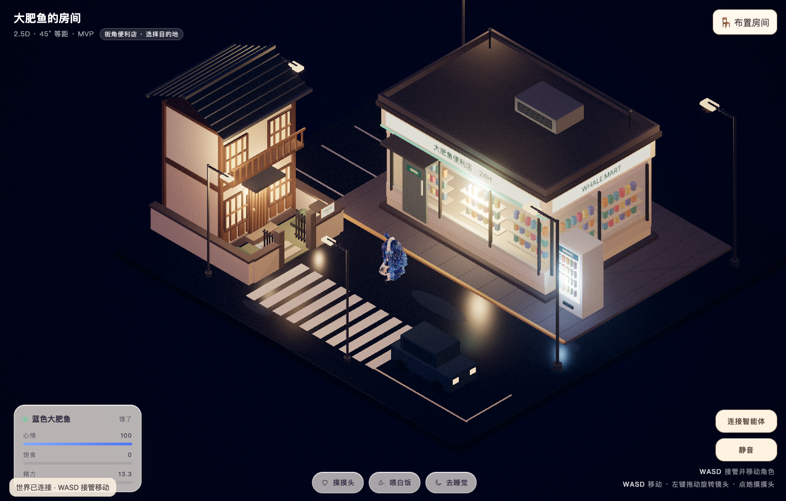
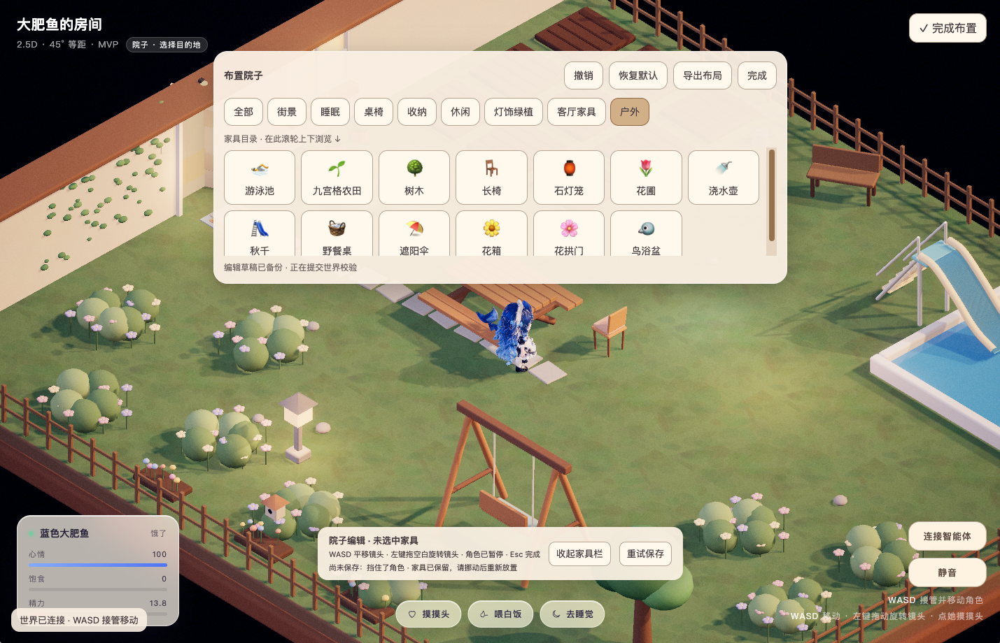

# 大肥鱼的小世界

一个用 Three.js 制作的 2.5D 陪伴与世界搭建游戏。你可以陪大肥鱼生活、布置房间，也可以通过 **MCP 让自己的智能体进入、探索并改造这个世界**。

**作者 / 抖音：破晓手记**

## 游戏画面

### 夜间便利店与日式小楼



### 卧室与庭院


### 泳池变身与家具编辑




## 开始游戏

需要 **Node.js 22.13+，推荐 Node.js 24**。

```bash
git clone https://gitee.com/poxiao12138/dafeiyu-room.git
cd dafeiyu-room
npm ci
npm run dev
```

打开 **[http://127.0.0.1:5200/](http://127.0.0.1:5200/)**。前端与后端一起启动，SQLite 存档自动创建，无需安装数据库。

- **WASD** 移动，走到门口切换场景；户外左键拖动旋转镜头，室内可小幅转动。
- 点击角色摸头，喂白饭、睡觉恢复状态；滑入泳池变成胖鲸鱼，上岸恢复人形。
- 点击 **布置房间** 添加、拖动家具；滚轮或 **R** 旋转，右键打开菜单。位置不合适时保留预览，可继续调整。
- 四个初始场景已包含在项目中。院子保留九块农田，种菜与购物系统尚未实现。

正式运行：`npm run build` 后执行 `npm start`，入口仍为 5200。开发与正式服务不要同时启动。

## 让智能体通过 MCP 进入世界

MCP 是智能体访问游戏的工具接口。它能让你的智能体看懂世界状态、控制角色、摆放家具和连接新场景，而不是只在聊天里描述自己做了什么。

1. 在游戏右下角点击 **连接智能体 → 复制地址**。
2. 将地址添加到支持 **Streamable HTTP + OAuth** 的 MCP 客户端，在授权页确认权限。
3. 让智能体调用 `world_enter {}`，随后根据工具返回的地图、目录和规则行动。

```text
http://127.0.0.1:5200/mcp
```

| 能力 | 智能体可以做什么 |
| --- | --- |
| 观察 | 查看场景、家具、角色状态和世界事件 |
| 行动 | 跨场景走动、坐下、吃白饭、睡觉、游泳、滑梯 |
| 建设 | 预览并提交场景和家具改造，连接场景、撤销建设 |
| 播放音频 | 提供已生成的语音，由游戏播放；游戏不合成语音、不采集麦克风 |

游戏统一校验碰撞、农田保护、门口通道与镜头规则；主人可随时接管角色、撤销智能体授权。**智能体的后续决策和定时唤醒由 DSH 等宿主负责**，游戏服务负责保存世界并执行已接受的动作。

默认地址仅供同一台电脑使用。只支持 stdio 的客户端可用项目适配器；远程部署、授权范围和参数示例见 **[MCP 对接手册](docs/MCP-QUICKSTART.md)**，可复制的提示词见 **[智能体接入提示词](docs/MCP-PROMPTS.md)**。

## 存档与开发

- 默认布局：`shared/world/starter-world.json`，用于创建新世界。
- 个人存档：`data/game.sqlite`，已排除在 Git 之外。日常操作和 AI 改造只保存到数据库，不会改写发布默认数据。
- 角色模型及配音已随项目提供；默认使用鲸鱼娘，`?character=whale` 可切换程序化胖鲸鱼。

```bash
npm run check       # 测试、构建与公开资源检查
npm run self-check  # MCP 授权与世界操作流程自检
```

更多说明：[文档目录](docs/README.md) · [踩坑日记](docs/PITFALLS.md) · [存档与默认世界](docs/WORLD-SAVES.md)

## 来源与许可

代码及作者有权授权的角色资源、配音和项目截图采用 **[MIT License](LICENSE)**，允许商用，须保留版权与许可声明。角色包含使用付费 Meshy 服务生成、由作者修复和编辑的模型；素材授权限于作者实际拥有的权利。

主要使用 Three.js、Fastify、MCP TypeScript SDK、Zod、Vite 等开源组件；详细来源与版权文本见 **[第三方声明](THIRD-PARTY-NOTICES.md)**。开发中也参考体验了 [茉莉的小房间 / norsizu](https://github.com/norsizu/moli-room)，其许可独立。

欢迎在仓库的问题反馈（Issues）中提建议，或到抖音「破晓手记」交流。
